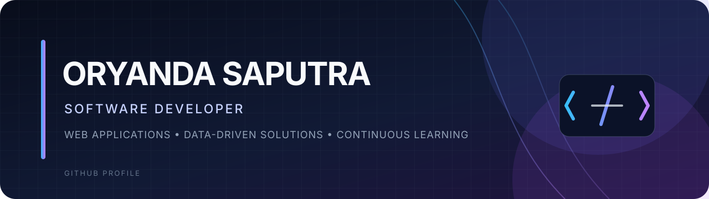

  

<h1 align="center">Hi, I'm Oryanda Saputra 👋</h1>

  

  
  
  
  
  

  
  

---

## 👨‍💻 About Me

I'm a software developer interested in building useful, maintainable, and user-friendly digital products.

- 💻 Focused on web application development and practical software solutions.
- ⚛️ Working with JavaScript, TypeScript, React, and Next.js.
- 🧩 Building backend features and data-driven applications with Node.js, PHP, Laravel, and relational databases.
- 🛠️ Interested in clean code, application security, documentation, and reliable development workflows.
- 🌱 Always learning, experimenting, and improving through hands-on projects.

> I enjoy turning real-world problems into software that is clear, useful, and maintainable.

## 🧰 Tech Stack

The icons below are loaded from Skill Icons. Select an icon row to open the icon catalog.

**Languages**

  

**Frontend**

  

**Backend & Database**

  

**Tools**

  

## 🚀 Featured Projects

A few repositories that represent the technologies and application areas I'm exploring:

<table>
  <tr>
    <td width="50%">
      <h3>🌐 PersonalWeb</h3>
      
Personal portfolio project built on Next.js, React, and TypeScript. The repository documents the foundation and planned portfolio architecture.

      
    </td>
    <td width="50%">
      <h3>📦 Inventaris_Pupuk</h3>
      
Inventory application starter using Next.js, Prisma, PostgreSQL, and Auth.js, with role-based access concepts.

      
    </td>
  </tr>
  <tr>
    <td width="50%">
      <h3>⚡ Laravel11-Inertia-React</h3>
      
A Laravel 11 and React starter project with installation notes for local development.

      
    </td>
    <td width="50%">
      <h3>🔎 More Projects</h3>
      
Explore the rest of my public repositories, experiments, and ongoing work.

      
    </td>
  </tr>
</table>

## 📊 GitHub Activity

  
  

  

  
<b>✨ A little more about how I work</b>

   

  - I value readable code and clear project structure.
  - I prefer documenting setup steps so projects are easier to run and maintain.
  - I like building applications that connect frontend experiences, backend logic, and data.
  - I keep learning by shipping projects and improving them over time.

## 🤝 Connect

  
  

  <i>Thanks for visiting my profile. Feel free to explore my repositories!</i>

